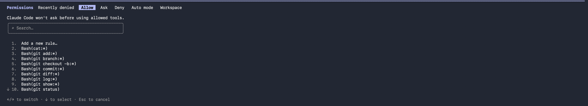

# HW4 Part 1: Claude Code project setup log

Annotated record of how the Claude Code setup was built. Screenshots go in `docs/hw4/screenshots/`.

## Before this class (my notes)

Usually, I didnt think much about it and just created a Claude Code session. I would install the Karpathy skill but that is it. no CLAUDE.md, no permissions, no plan.

## 1. Scaffold and tooling

- Scaffolded Next.js 16 (App Router, TypeScript, Tailwind, ESLint).
- Added Vitest, coverage, Playwright, Prettier, and fast-check, plus `test`, `typecheck`, `format`, and `test:e2e` scripts.
- Commits: `chore: scaffold Next.js app ...`, `chore: add test, format and typecheck tooling`.

## 2. Supporting docs written before /init

- `docs/PRD.md`: problem, roles, user stories, testable acceptance criteria, security criteria.
- `docs/architecture.md`: ADRs (stack, pure scheduler module, layering, server-side authz, reschedules as proposals, deterministic generation).
- `docs/testing.md`: test pyramid, TDD rules, property tests, coverage target.
- `docs/context-management.md`: when we use `/clear`, `/compact`, `--continue`, `--resume`, `/context`.

## 3. Permissions

`.claude/settings.json` is checked in so both partners get the same rules:

- **allow:** test, lint, typecheck, format, and read-only or local git commands, so the TDD loop runs without prompts.
- **ask:** installing packages, migrations, pushing, merging, opening PRs, deploys, web fetches.
- **deny:** reading or editing `.env*` and `*.pem`, hand-editing migrations, `rm -rf`, force push, `git reset --hard`, `git clean`, `prisma migrate reset`, curl/wget.

Personal overrides go in `.claude/settings.local.json`, which is git-ignored.

**My notes:** nope, overall it looked good. no prompts got annoying yet and nothing allowed that shouldnt be.

Screenshot of `/permissions` showing the allow rules loaded from the file:

## 4. /init and iteration

1. Ran `/init` in Claude Code and committed its raw output unchanged (`docs: CLAUDE.md from /init (unedited)`).
2. Compared it against what the project needs.
   - **Got right:** it read the docs we had already written and summarized the layering and authorization rules accurately. It also caught things we had not written down: `next.config.ts` enables `cacheComponents` and `partialPrefetching`, route-type globals like `LayoutProps` only exist after `next typegen`, Vitest only collects `.ts` files in a node environment, and how to run a single test. It said the repo is still a scaffold and most of the architecture is planned.
   - **Missed:** it referenced `docs/PRD.md` and the other docs as plain paths instead of `@imports`, so their content would not load into a session automatically. Because of that it copied big parts of those docs inline, which duplicates them and will drift. It had no coding conventions (naming, typed service results, date handling, commit and branch format), no do's and don'ts, no OWASP notes, and no Definition of Done.
3. Rewrote CLAUDE.md: kept the useful `/init` findings (Next.js 16 notes, single-test commands, Vitest scope, project status), replaced the inline copies with `@imports` (PRD, architecture, testing, context management, and the Next.js `AGENTS.md`), and added conventions, do's and don'ts, OWASP Top 10 notes, and a Definition of Done. Committed as `docs: update CLAUDE.md after /init`.

The diff between the two commits is the evidence of iteration: `git log -p -- CLAUDE.md`.

**My notes:** very suprised by the quality, after a bit of stearing it got exactly what I needed. never knew about /init before this.

## 5. Context management in practice

What I've actually used so far:

- **`claude --resume`**: reopened the session where Plan mode reviewed the league setup plan, then `/export`ed it to `docs/hw4/sessions/part2-plan-review.txt` so the log is in the repo.
- **Fresh session per task (same idea as `/clear`)**: the explore session for US-3 was started new instead of continuing the review session, so it only had CLAUDE.md and the imported docs in context, not the whole review conversation. Export: `docs/hw4/sessions/part2-explore.txt`.
- **`@imports` instead of pasting docs**: both sessions answered from the PRD and ADRs without me pasting anything, because CLAUDE.md imports them.

`/context`, `/compact`, `/clear`, and `claude --continue` were all used during the Part 3 TDD session, with screenshots, in `docs/hw4/part3-tdd-log.md`.
