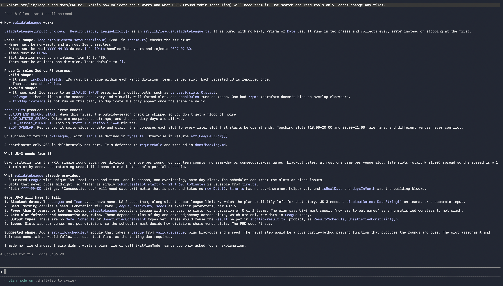
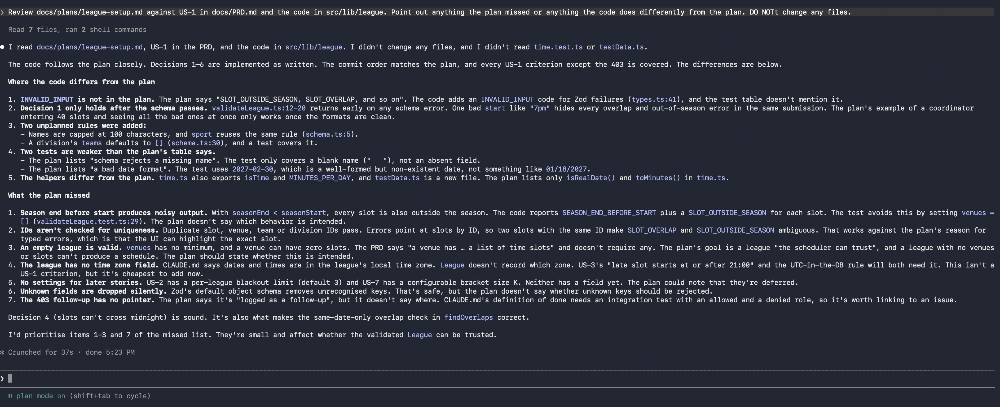

# HW4 Part 2: Explore, Plan, Implement, Commit

Feature: **US-1 league setup** (docs/PRD.md). Turns raw "create league" input into a validated `League` the scheduler in Part 3 can trust.

How it was run:

- Explore, plan, implement, and commit for the first version: Claude (Opus 5.5) in an agent session with file and shell access to this repo, using the same tool pattern as Claude Code (glob/grep/read to explore, a written plan before any code, then implementation and commits). Tests ran with Vitest after every step.
- Plan mode review and the US-3 explore: my own Claude Code sessions (v2.1.330, Sonnet 5.5), both in Plan mode. Exports are in `docs/hw4/sessions/`.

## 1. Explore

Goal: find out what already exists and what rules the code has to follow, without writing anything.

What was run, and what it turned up:

| Step                          | Command                                             | Finding                                                                                                                             |
| ----------------------------- | --------------------------------------------------- | ----------------------------------------------------------------------------------------------------------------------------------- |
| List source and docs          | `find src docs tests -type f`                       | `src/` only has the Next.js scaffold. No `tests/` folder yet.                                                                       |
| Look for existing league code | `grep -rniE "league\|venue\|slot" src`              | Nothing. No code to reuse or conflict with.                                                                                         |
| Check dependencies            | `grep -n zod package.json`                          | Zod not installed, even though CLAUDE.md requires it at every server boundary.                                                      |
| Read the requirement          | `sed -n '/### US-1/,/### US-2/p' docs/PRD.md`       | 5 acceptance criteria. The last one (403 for non-coordinators) needs auth, which doesn't exist yet.                                 |
| Read the conventions          | `grep -nE "Result\|Date\|camelCase\|Zod" CLAUDE.md` | `src/lib` stays pure, dates and times are `"YYYY-MM-DD"` / `"HH:MM"` strings, no `new Date()` in `src/lib`, tests sit next to code. |

Second explore, in my Claude Code session (Plan mode, read-only), after the fixes. Asked it to explain how `validateLeague` works and what US-3 will need from it. It read 8 files and listed the gaps US-3 has to fill (no blackout dates or seed on `League`, no `Game`/`Schedule` types, a league can still have 0 or 1 teams, how divisions share venue slots). That list is the starting point for Part 3. Full export: `docs/hw4/sessions/part2-explore.txt`.

Why it mattered: the explore step changed the plan. Without it, the obvious move would have been `Date` objects and a create-league server action. CLAUDE.md rules out the first, and the missing auth layer rules out doing the second properly right now.

## 2. Plan

The plan was written to `docs/plans/league-setup.md` and committed before any code (`21b8b53`), so the plan is part of the history.

Main decisions in it:

1. Return every error at once (`Result<League, LeagueError[]>`), so a coordinator with 40 slots sees all the bad ones in one pass.
2. Typed error codes (`SLOT_OUTSIDE_SEASON`, `SLOT_OVERLAP`, ...) with venue and slot IDs, so the UI can point at the exact slot and tests don't depend on message wording.
3. Keep dates as strings. Same-format `YYYY-MM-DD` strings compare correctly with `<`, so "inside the season" needs no `Date` or time zone logic.
4. Slots can't run past midnight. Not in the PRD, added here. It means only same-date slots can overlap, which keeps the overlap check simple.
5. Touching slots (19:00-20:00 and 20:00-21:00) are not an overlap.
6. Deferred the 403 criterion to when `requireRole()` exists, instead of faking it, and wrote down why.

The plan also maps every acceptance criterion to the tests that cover it.

## 3. Implement

Built in the order the plan's commit list gave:

1. `src/lib/result.ts`, `src/lib/league/types.ts`, `time.ts`, `schema.ts` with tests for date and time parsing and the Zod schema. `isRealDate()` checks the calendar by hand so `2027-02-30` and `1900-02-29` are rejected.
2. `validateLeague()` for season dates, slots outside the season, and slots past midnight, with boundary tests (first and last day of the season allowed, a slot ending exactly at 24:00 allowed).
3. Overlap detection. Slots are sorted by date and start time, then each slot is compared with every later slot that starts before it ends. Only comparing each slot with the next one would miss a case: one long slot (18:00-21:00) overlapping two short ones. There is a test for exactly that, with the slots given out of order.

One problem during implementation: the overlap tests didn't make it into the first test run (a stale copy of the test file). Coverage caught it. `validateLeague.ts` showed line 68, the `SLOT_OVERLAP` push, as never executed, and the test count was 24 instead of 30. The file was re-synced and re-run before committing, so the overlap commit includes its tests.

Final state: 30 tests pass, 100% statement, branch, function, and line coverage on `src/lib`, `typecheck`, `lint`, and `prettier --check` clean.

## 4. Commit

| Commit                                                                            | What                             | Tests after |
| --------------------------------------------------------------------------------- | -------------------------------- | ----------- |
| `21b8b53` docs: plan for league setup (US-1)                                      | the plan                         | n/a         |
| `5b3086d` add zod + league types and input schema                                 | types, result helper, Zod schema | 14 passing  |
| `1cb8980` validateLeague: season dates, slots outside season, slots past midnight | first validation rules           | 24 passing  |
| `7d1db17` check for overlapping slots at the same venue                           | overlap detection                | 30 passing  |

Each commit builds and passes on its own, so any of them can be checked out and run.

## Acceptance criteria status

| US-1 criterion                                              | Status                                |
| ----------------------------------------------------------- | ------------------------------------- |
| League has name, sport, season dates, one or more divisions | done, `schema.test.ts`                |
| Venue has a name and slots (date, start, duration)          | done, `schema.test.ts`                |
| Slots outside the season are rejected                       | done, `validateLeague.test.ts`        |
| Two slots at the same venue cannot overlap                  | done, `validateLeague.test.ts`        |
| Only coordinators can create or edit leagues (403)          | deferred until auth exists (see plan) |

## 5. Plan mode review

After the four commits, the plan was reviewed in my own Claude Code session in Plan mode (read-only), asking it to compare `docs/plans/league-setup.md` against US-1 and the code in `src/lib/league` without changing any files.

It read 7 files and confirmed the code follows the plan's six decisions and commit order. It also found real gaps:

- **Code vs plan:** an `INVALID_INPUT` code the plan never listed; schema errors return early, so one bad `"7pm"` hides every overlap error in the same submission (weakening decision 1); two tests are weaker than the plan's table claims (blank name instead of missing name, `2027-02-30` instead of a wrong format like `01/18/2027`).
- **Missed by the plan:** a season that ends before it starts also reports every slot as outside the season; slot, venue, team, and division IDs aren't checked for uniqueness, which makes error IDs ambiguous; a league with no venues or slots passes; the 403 follow-up isn't linked to an issue.

Full export of the session: `docs/hw4/sessions/part2-plan-review.txt`.

**My notes:** the one I wouldnt have caught myself is duplicate ids.

## 6. Fixes from the review

Back in implement and commit for three of the findings, each with tests in the same commit:

| Commit                                                                      | Finding it fixes                                         | Tests after |
| --------------------------------------------------------------------------- | -------------------------------------------------------- | ----------- |
| `b87dbe4` only report the season error when season dates are backwards      | backwards season also flagged every slot                 | 30 passing  |
| `076e630` reject duplicate ids (slots, venues, divisions, teams)            | duplicate IDs made errors ambiguous                      | 35 passing  |
| `b83af2a` keep checking well-formed slots when part of the input is invalid | one bad field hid all rule errors; two weak schema tests | 42 passing  |

How the third one works: when the schema fails, `validateLeague()` still pulls out the season dates (if both are real dates) and every slot that passes `timeSlotSchema` on its own, then runs the same overlap, season, and midnight checks on those. Broken venues are skipped instead of crashing.

The plan was updated with these as decisions 7 to 10, plus what was considered and left for later (empty leagues, time zone, unknown fields). The 403 criterion has issue text in `docs/backlog.md`.

Final state: 42 tests, 100% coverage on `src/lib`, typecheck, lint, and Prettier clean.

## My notes on the workflow

- **Slower than just coding?** at first it did but not after I got the hang of it.
- **Next time:** run the plan mode review right after the plan, before any code. would of saved the 3 fix commits.
