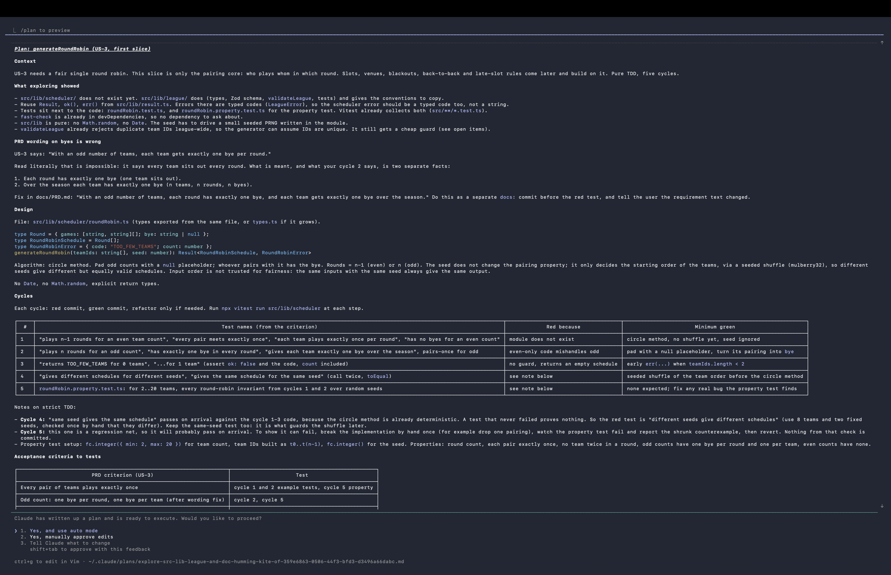
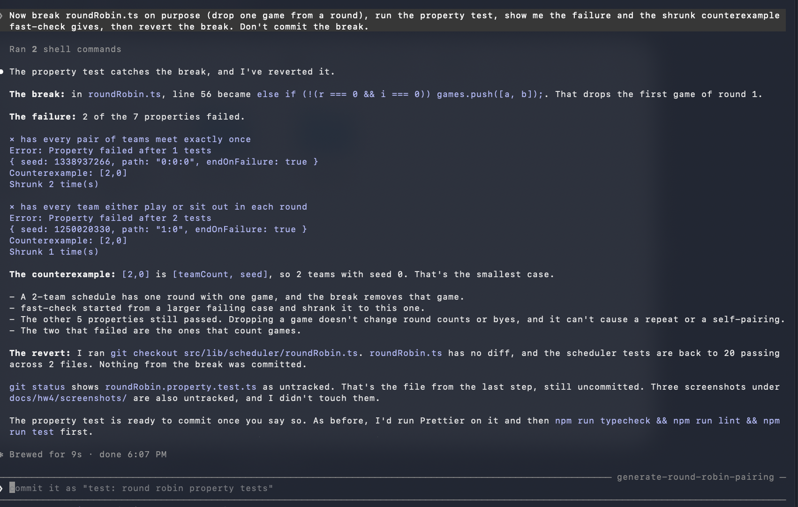
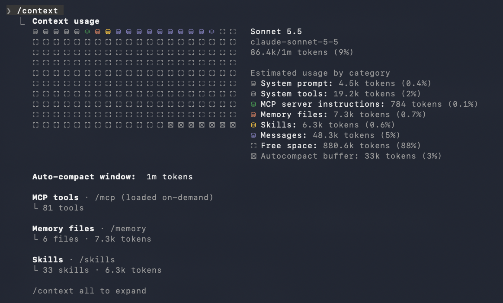
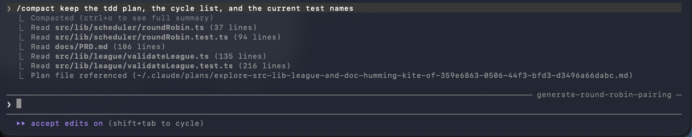
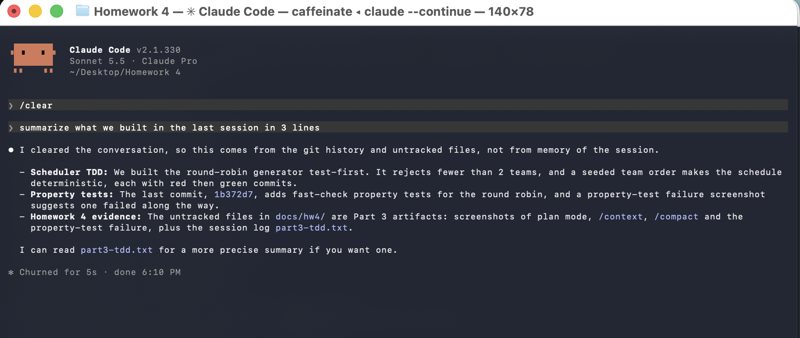

# HW4 Part 3: TDD with Claude Code

Feature: **round-robin pairing**, the core of US-3. `generateRoundRobin(teamIds, seed)` in `src/lib/scheduler/roundRobin.ts` returns who plays whom in each round. Slots, venues, blackouts, and the back-to-back rule come later and build on it.

Run entirely in my own Claude Code session (v2.1.330, Sonnet 5.5). Full export: `docs/hw4/sessions/part3-tdd.txt`.

## Setup before the first test

1. **CLAUDE.md first.** Added a convention that commit messages are short, lowercase, and have no Co-Authored-By lines (`e1adda2`). Another CLAUDE.md iteration, made because Claude Code adds attribution lines by default.
2. **Plan mode.** Asked it to explore `src/lib/league` and US-3 in the PRD, then plan five TDD cycles and save the plan to `docs/plans/round-robin.md` (`bc4f105`).

Things the plan caught before any code was written:

- **The PRD was wrong.** US-3 said "each team gets exactly one bye per round", which would mean every team sits out every round. Fixed to "each round has exactly one bye, and each team gets exactly one bye over the season" as its own commit before the first test (`c365a15`).
- **A test that can't go red.** "Same seed gives the same schedule" would already pass before any seed code exists, since the circle method is deterministic. So the red test for cycle 4 became "different seeds give different schedules", with the same-seed test kept as a guard.
- **A property test that passes on arrival proves nothing on its own.** So cycle 5 includes breaking the code on purpose to show the property test can fail.

## The cycles

| Cycle                                                                               | Red commit                                        | Why it was red                                                | Green commit                                        | Tests after |
| ----------------------------------------------------------------------------------- | ------------------------------------------------- | ------------------------------------------------------------- | --------------------------------------------------- | ----------- |
| 1. Even team count: n-1 rounds, every pair once, everyone plays each round, no byes | `e65f733` test: even team count round robin (red) | module didn't exist yet                                       | `8cccc37` feat: even team count round robin (green) | 46          |
| 2. Odd team count: n rounds, one bye per round, one bye per team                    | `1f59b32` test: odd team count byes (red)         | 5 assertion failures (wrong round count, no byes)             | `2120b8d` feat: odd team count byes (green)         | 51          |
| 3. Fewer than 2 teams returns `TOO_FEW_TEAMS`                                       | `5a4734a` test: reject fewer than 2 teams (red)   | 2 assertion failures                                          | `8a63523` feat: reject fewer than 2 teams (green)   | 53          |
| 4. Seed decides the team order                                                      | `98267e1` test: seed changes the schedule (red)   | only "different seeds" failed; "same seed" passed as expected | `62b5edc` feat: seeded team order (green)           | 55          |
| 5. fast-check properties for 2 to 20 teams and random seeds                         | `f14603c` test: round robin property tests        | see below                                                     | none needed                                         | 62          |

Every red commit contains only test files, and every green commit only `roundRobin.ts`. Each red commit was checked out and run afterwards to confirm it really fails.

**Refactor steps:** asked after cycles 2 and 4. Both times Claude said no and explained why. After cycle 2 the function was about 25 lines and cycles 3 and 4 were about to change its shape. After cycle 4 it considered moving the seeded random helpers (`mulberry32`, `shuffled`) into a shared module, but nothing else uses them yet. No refactor commit was made rather than an empty one.

**Implementation:** the circle method. One team stays fixed and the rest rotate a place each round, so every pair meets exactly once. Odd counts get a placeholder, and whoever is paired with it has the bye. The seed drives a small seeded random generator (mulberry32) that shuffles the starting order, with no `Math.random`, so `src/lib` stays pure and deterministic.

## Proving the property test can fail

The property test passed on arrival, which is expected for a regression net. To show it actually checks something, I had Claude break `roundRobin.ts` on purpose (drop the first game of round 1), run it, then revert:

- 2 of the 7 properties failed: "every pair meets exactly once" and "every team either plays or sits out in each round".
- fast-check shrank the failure to the smallest case, `[2, 0]`: 2 teams, seed 0. A 2-team schedule has one game, and the break removes it.
- The other 5 properties still passed, which makes sense: dropping a game doesn't change round counts or byes.
- Reverted with `git checkout src/lib/scheduler/roundRobin.ts`. Nothing from the break was committed.

## Context management during the session

- **`/context`** after cycle 3, to see how full the session was before continuing.

- **`/compact keep the tdd plan, the cycle list, and the current test names`** right after. It kept the plan file and re-read `roundRobin.ts`, the tests, and the PRD, and cycles 4 and 5 continued without re-explaining anything.

- **`/export`** at the end to save the session log, then **`/clear`**, then **`claude --continue`** asking for a 3-line summary. Because of the `/clear`, Claude said it had no memory of the session and rebuilt the summary from git history and the files in `docs/hw4/`. That is the point of committing small and often: the history is the memory.

## Workflow change partway through

Cycle 1 ran in auto mode. The red and green commits landed 12 seconds apart with no pause to read the failing test in between. From cycle 2 on I switched to accept-edits mode and sent the red, green, and refactor prompts one at a time, reading each red run before asking for the green.

## Final state

- 62 tests pass (42 for league setup, 20 for the scheduler).
- `src/lib/scheduler`: 100% statements, branches, functions, and lines.
- `typecheck` and `lint` clean.
- The session export flagged a Prettier issue in `roundRobin.test.ts` that was never fixed during the session; fixed afterwards in its own formatting commit.

## Note on commit hashes

After grading feedback, older commit messages were reworded to add Conventional Commit prefixes (`feat:`, `fix:`, `chore:`, `docs:`, `style:`), which CLAUDE.md asks for. Rewording a commit changes its hash and the hash of every commit after it. The hashes in this log are the current ones. The session exports in `docs/hw4/sessions/` and the screenshots are left exactly as recorded, so they show the original hashes:

| Original (in exports and screenshots) | Current   | Commit                                    |
| ------------------------------------- | --------- | ----------------------------------------- |
| `ca70f59`                             | `e1adda2` | docs: claude.md commit msg style          |
| `e5faad0`                             | `bc4f105` | docs: round robin tdd plan                |
| `c14fe7e`                             | `c365a15` | docs: fix prd bye wording                 |
| `8ec825c`                             | `e65f733` | test: even team count round robin (red)   |
| `98de0ae`                             | `8cccc37` | feat: even team count round robin (green) |
| `e7f5b38`                             | `1f59b32` | test: odd team count byes (red)           |
| `102a275`                             | `2120b8d` | feat: odd team count byes (green)         |
| `df176c4`                             | `5a4734a` | test: reject fewer than 2 teams (red)     |
| `e0a34d6`                             | `8a63523` | feat: reject fewer than 2 teams (green)   |
| `7857f26`                             | `98267e1` | test: seed changes the schedule (red)     |
| `cc82a88`                             | `62b5edc` | feat: seeded team order (green)           |
| `1b372d7`                             | `f14603c` | test: round robin property tests          |

Code, tests, dates, and authorship are unchanged; only the message text moved.
